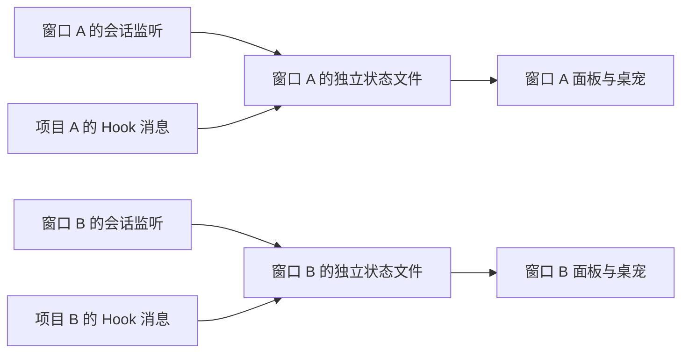

# v0.10.0 可靠性与使用体验记录

2026-10-20。本版集中处理审视中已确认的状态缺陷、偏好保存、低频调度和发布一致性。

## 状态生命周期

- `SessionMonitor.update()` 原位更新回答摘录和工作区范围，保留仍在范围内的会话、游标、去重信息、计数和任务开始时间。
- 新加入项目先为已有文件建立基线，不回放打开前的历史；旧项目中尚未读完的记录继续增量处理。
- 移除项目会立即撤掉其会话，最后一个任务移除时发送空活动以清除显示。范围修订号阻止正在进行的异步发现和读取把移除对象加回来。
- 会话根目录改变或显式关闭监听仍会销毁监听器。因为数据源已变化，不沿用其他目录的任务。
- 回答显示更新与动画状态切换分开：关闭摘录不打断当前互动，也不重复播放同一次完成动画。

## 窗口隔离与 Hook 兼容

独立运行快照使用进程号和 UUID，正常停用仅删除自己的文件。传统 Hook 的消息地址根据完整规范化项目路径生成哈希，跨升级保持不变，避免同名目录冲突。各窗口只读取当前打开的项目；多个项目并行时，仍在工作者优先于已完成者。启动时不回放旧消息。

此版选择每窗口独立显示；没有增加全局协调进程。`reportActivity` 命令只改变接收命令的窗口。

## 偏好与调度

偏好按规范化工作区组合保存在扩展全局目录，包括展开位置、尺寸、静音、吸附和完成时自动展开。设置中的尺寸改动优先于旧的菜单尺寸。WPF 按当前可用显示器工作区恢复位置；Tk 暂按主屏幕恢复。

收起时先等待 340ms 滑入结束，再按 5000ms～5230ms 的眨眼区间及 7200ms 周期唤醒；休眠表情可等待 60 秒。展开和新事件立即请求绘制。计时模型中，普通探头 60 秒内不足 20 次动画回调，原先 WPF / Tk 分别固定约 750 / 600 次；这不包含仍然保留的状态检查，也不是实测 CPU 降幅。

## 验证

统一入口为 `npm run verify`，可加 `--browser --tk`。自动检查包含：

- 设置变化、工作区增减和异步发现竞争期间继续收到任务结束。
- 两个扩展实例共用全局目录时的隔离，以及按项目路由的传统 Hook。
- 偏好往返、损坏配置回退、尺寸配置优先和显示器移除。
- 21 段动画的 858 个时间边界在 JS、Python、PowerShell 中一致；该检查针对真实换帧函数，不等同于三端全部交互路径一致性证明。
- WPF 与 Tk 实际加载 152 张去重图片，检查工作、拖动、完成和偏好；浏览器检查真实 HTML、资源解码、互动恢复与减少动态效果。
- VSIX 所需新模块、全部 PowerShell 的 BOM 和构建版本信息。

本机验证覆盖 Windows WPF、Windows Tk 和无头 Edge。新增 Linux CI 的 Xvfb / Tk 与 Chromium 流程，需推送后由 CI 实际运行；macOS 原生安装、真实跨显示器拖动和长时间挂机资源占用仍未在本轮测量。

## 发布约束

普通构建仅上传 CI artifact。正式发布独立到仅标签触发且具有写权限的 job；标签必须等于包版本，不再覆盖旧 Release。VSIX 记录提交及 dirty 标记，CI 输出 SHA256SUMS。此轮只生成本地安装包，不提交、推送、安装或发布。
